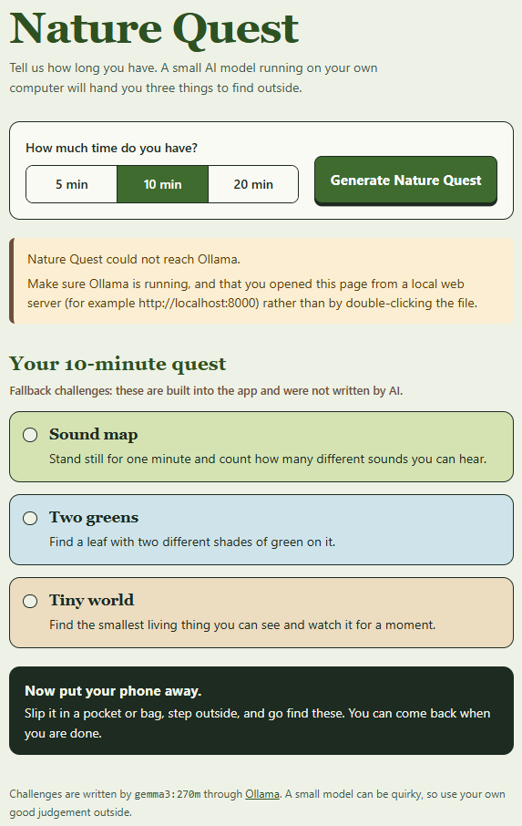

# Nature Quest 🌿

**Put the screen down. Go touch grass.**

Nature Quest is a small website that gives you something to do outside. You pick how much time you have, and a local open-weight AI model (Gemma, running through Ollama) writes three short nature challenges for you to go and find.



## The Problem

It's easy to say "I should go outside" and then spend the break scrolling instead. A walk is more fun when you have something to look for, but it's hard to come up with ideas on the spot.

## The Solution

1. Choose how much time you have: 5, 10 or 20 minutes.
2. Click **Generate Nature Quest**.
3. Get three simple outdoor challenges, each with a short title and one sentence telling you what to find or notice.
4. Put your phone away and go find them.

The challenges are written by the AI model each time. They are not hardcoded. If the AI fails, the page shows built-in fallback challenges and clearly labels them as not written by AI.

## Tech Stack

- HTML, CSS and vanilla JavaScript
- [Gemma](https://ai.google.dev/gemma) (`gemma3:270m`), an open-weight model
- [Ollama](https://ollama.com) to run the model locally

## How It Works

1. `app.js` reads your time choice and builds a prompt with safety rules (no eating, climbing, swimming, touching animals, or using phones).
2. It sends the prompt to Ollama's local chat API (`http://localhost:11434/api/chat`) with a JSON schema, so the model replies in a fixed structure.
3. The reply is checked before it is shown. Challenges with the wrong length, duplicate tasks, links, or risky or off-topic words (such as "climb", "eat" or "phone") are thrown out.
4. If three good challenges remain, they appear as cards.
5. If the model is unreachable, too slow (90 second timeout), or returns fewer than three usable challenges, the page explains what went wrong and shows three random fallback challenges instead.

## Run It Locally

You need [Ollama](https://ollama.com/download) and any local web server.

```bash
# 1. Download the model
ollama pull gemma3:270m

# 2. Clone this repo
git clone https://github.com/SwagD15/NatureQuest.git
cd NatureQuest

# 3. Serve the page, for example
python -m http.server 8000
```

Then open <http://localhost:8000> and click **Generate Nature Quest**.

### Using a different model

Open `app.js` and change the `MODEL` line at the top. Larger models such as `gemma3:1b` or `gemma3:4b` usually write better challenges. Run `ollama list` to see the exact names of the models you have installed.

### Troubleshooting

- **"Could not reach Ollama":** Make sure Ollama is running, and open the page through `http://localhost:8000`, not by double-clicking `index.html`. If your browser still blocks the request, allow the page's origin and restart Ollama, for example `OLLAMA_ORIGINS="http://localhost:8000" ollama serve` on Mac/Linux.
- **"Model is not downloaded":** Run `ollama pull gemma3:270m`.
- **"Took too long to answer":** The first request can be slow while the model loads. Try again in a moment.
- **"Not in a form we could use":** Small models sometimes fail to follow the format. Click the button again.

## Limitations

- `gemma3:270m` is very small. It is fast and runs on almost any computer, but it can write generic or odd challenges. Use your own good judgement outside.
- The word filter is a safety net, not a guarantee. It can't catch every unsafe suggestion.
- The app needs Ollama running on your own computer, so it can't be hosted publicly on a site like GitHub Pages and used by other visitors without extra setup.

## Open Innovation

Nature Quest uses an open-weight model that runs entirely on the user's own machine. There are no API keys, no usage fees and no data sent to a third-party service. Anyone can swap in a different model, change the prompt, or edit the fallback challenges.

## Project Structure

```
NatureQuest/
├── index.html   # page structure and time picker
├── style.css    # styling
├── app.js       # prompt, Ollama call, validation, fallbacks, results display
├── LICENSE
└── README.md
```

## Built For

Anyone who wants a small reason to step outside for a few minutes. The idea is that the screen should be the shortest part of the experience: generate a quest, then put the phone away.

## Project Status

Built for the [Hacktoberfest Open-Source AI Challenge: Week 1](https://dev.to/challenges/hacktoberfest-week1-2026-10-05) (theme: **Touch Grass**), 2026.

## License

MIT License
